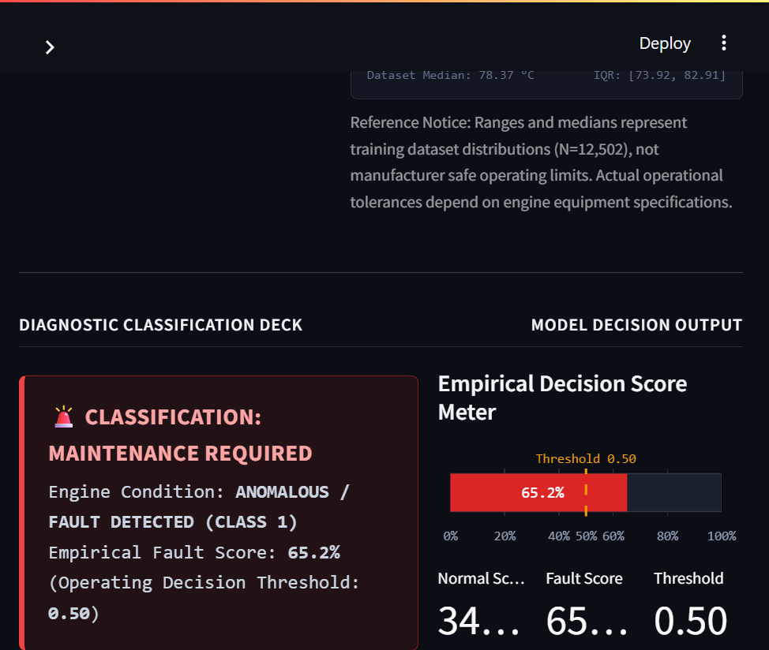
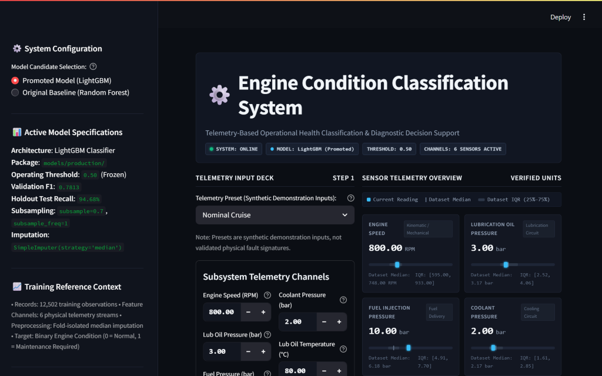
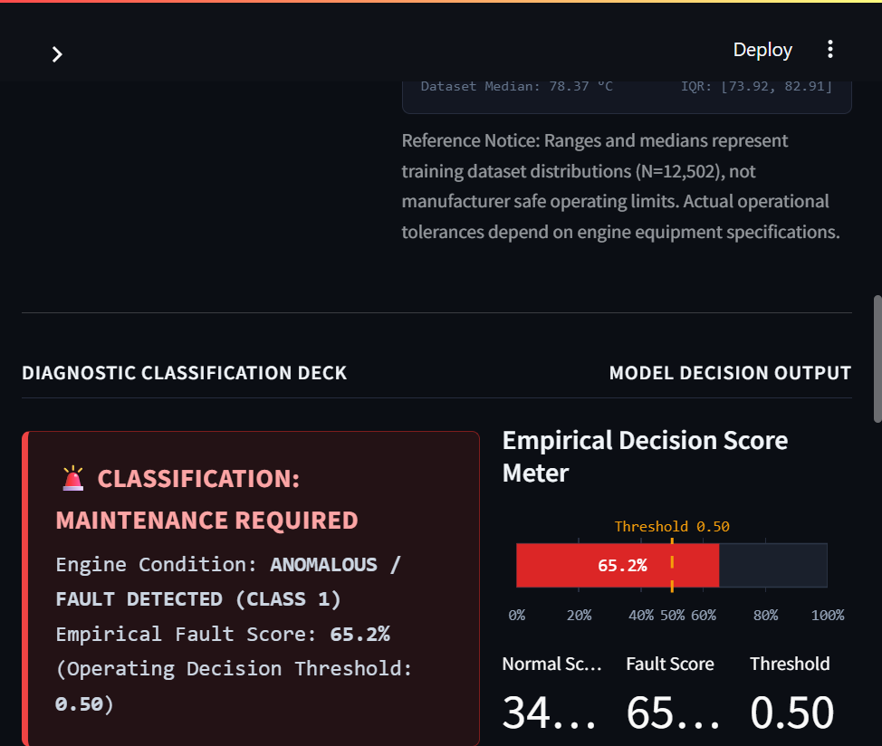
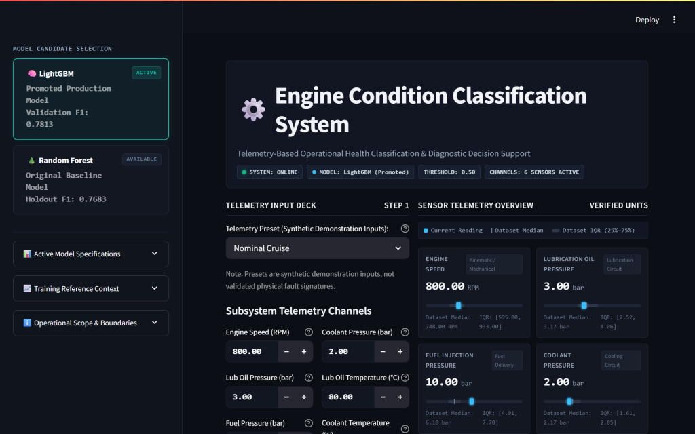
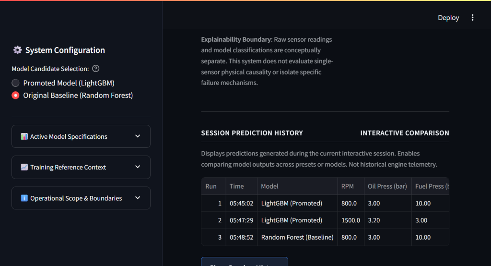
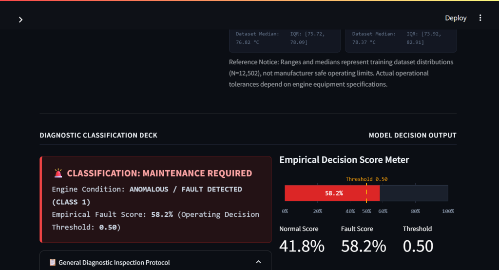
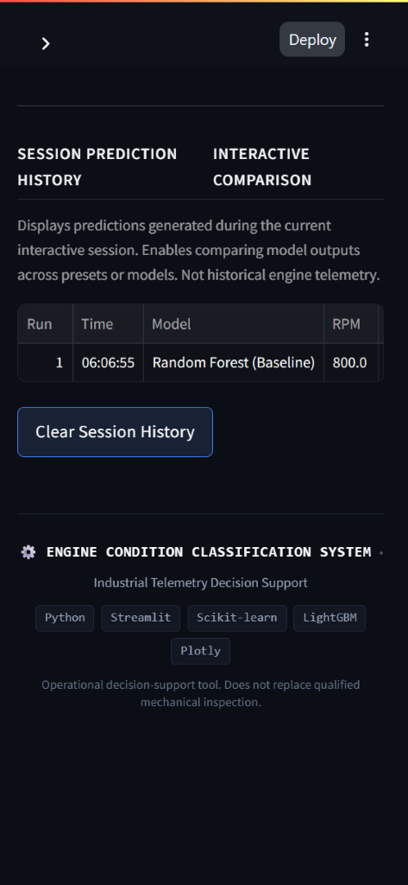
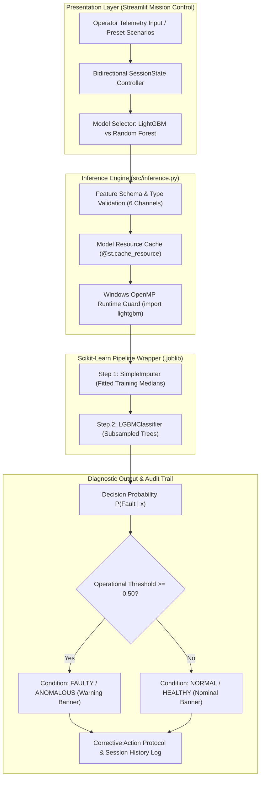

# EngineSense — Predictive Maintenance & Condition Classification

[](https://www.python.org/)
[](https://scikit-learn.org/)
[](https://lightgbm.readthedocs.io/)
[](https://streamlit.io/)
[](LICENSE)
[](tests/)

**Lead ML Engineer & Author**: [Abhishek Tiwari](https://github.com/Abhi-code15)

An industrial machine learning application and interactive diagnostic dashboard for instantaneous multicore engine condition classification. The system ingests six continuous physical telemetry streams, validates them against strict schema constraints, applies leakage-free preprocessing, and classifies operational health using a promoted LightGBM gradient boosting model running alongside the original Random Forest baseline.

---

## Application Showcase

The application features an **Industrial Mission-Control** interface engineered for clarity, tactile interaction feedback, and telemetry inspection:



<div align="center">
  <sub>Figure 1: Full desktop dashboard displaying live telemetry cards, continuous decision gauge, model metadata, and corrective action protocol.</sub>
</div>

<br>

### Interface Details

| Telemetry Input Deck | Diagnostic Risk Evaluation |
|:---:|:---:|
|  |  |
| *Six dedicated physical sensor cards with units, step buttons, and training interquartile reference bounds.* | *High-visibility status banner, calibrated probability meter, and tiered diagnostic action items.* |

| Selectable Model Cards | Cross-Model Session History |
|:---:|:---:|
|  |  |
| *Sidebar model switcher comparing promoted LightGBM against original Random Forest baseline.* | *FIFO session audit ring buffer preserving raw telemetry, model provenance, and timestamps.* |

| Mobile Responsive Deck | Mobile Diagnostic Footer |
|:---:|:---:|
|  |  |
| *Single-column stacked telemetry cards with zero horizontal overflow on mobile viewports (375px).* | *Responsive industrial footer displaying production runtime metadata and cryptographic hashes.* |

---

## Key Capabilities & Engineering Highlights

- **Predictive Engine Condition Classification**: Detects early thermodynamic and hydraulic anomalies across mechanical, lubrication, and cooling loops before in-service degradation compounds into mechanical failure.
- **Leakage-Free ML Pipeline**: Median imputation (`SimpleImputer`) is fitted exclusively within training folds ($N=12,502$), guaranteeing that no validation or holdout information ever leaks into the preprocessing transformers.
- **LightGBM Subsampling Correction**: Discovered and resolved a silent bagging failure in LightGBM where `subsample=0.7` is ignored when `subsample_freq=0`. Explicitly configuring `subsample_freq=1` activated stochastic bagging, outperforming the Random Forest baseline.
- **48.63% Reduction in Missed Faults**: On the isolated holdout test set ($N=3,907$), the promoted model reduced false negatives from 255 to 131, elevating operational recall from 89.65% to **94.68%**.
- **Vectorized High-Throughput Inference**: Measured **0.0525 seconds** across 3,907 holdout batch predictions (~**0.0134 ms/sample**, ~**74,400 samples/sec** throughput) on the development host, executing ~3.5x faster than the Random Forest ensemble (see benchmark notes).
- **Domain Feature Engineering Evaluation**: Evaluated 5 physically motivated interaction features (temperature difference, pressure ratio, RPM-normalized pressures, circuit differential). Empirical testing showed feature engineering increased training time without improving validation performance (CV F1 0.7756 vs. 0.7778, recall 93.05% vs. 95.69%), leading to the retention of the clean 6-sensor schema.
- **State-Synchronized Streamlit Interface**: Bidirectional session state machine prevents stale widget states: selecting a preset populates all inputs; modifying any sensor decouples the preset and updates the UI to `"Custom Input"`.
- **Cross-Platform C++ OpenMP Safety**: Resolves Windows dynamic-link threading conflicts by guaranteeing `lightgbm` C++ OpenMP runtime libraries are initialized prior to unpickling serialized `.joblib` pipelines.

---

## System Architecture



For detailed architectural specifications, component boundaries, and concurrency profiles, refer to [System Architecture](docs/architecture.md).

---

## Dataset & Telemetry Channels

The system evaluates six continuous telemetry streams captured from engine monitoring transducers:

| Channel Name | Measurement | Units | Subsystem | $P_{25}$ | Median ($P_{50}$) | $P_{75}$ |
|:---|:---|:---:|:---|:---:|:---:|:---:|
| `Engine_RPM` | Rotational Speed | RPM | Mechanical / Drivetrain | 595.00 | **748.00** | 933.00 |
| `Lub_Oil_Pressure` | Oil Gallery Delivery Pressure | bar | Fluid Lubrication | 2.52 | **3.17** | 4.06 |
| `Fuel_Pressure` | Injection Rail Pressure | bar | Fuel Delivery System | 4.91 | **6.18** | 7.70 |
| `Coolant_Pressure` | Jacket Circulation Pressure | bar | Engine Cooling Loop | 1.61 | **2.17** | 2.85 |
| `Lub_Oil_Temperature`| Sump / Gallery Oil Temp | °C | Lubrication Thermal | 75.72 | **76.82** | 78.09 |
| `Coolant_Temperature`| Cylinder Head Coolant Temp | °C | Thermal Management | 73.92 | **78.37** | 82.91 |

- **Target Variable (`Engine_Condition`)**:
  - `0`: **Normal / Healthy** (36.95% of training samples).
  - `1`: **Warning / Fault** (63.05% of training samples).
- **Partitioning**: 19,535 total rows partitioned into Training ($N=12,502$), Validation ($N=3,126$), and Holdout Test ($N=3,907$).
- **Dataset Provenance & License**: Sourced from the [Automotive Vehicles Engine Health Dataset on Kaggle](https://www.kaggle.com/datasets/parvmodi/automotive-vehicles-engine-health-dataset) by Parv Modi (`engine_data.csv`, 19,535 records, published under **CC0: Public Domain** dedication; registered on Hugging Face Hub as `Abhishektripathiak/engine-maintenance-dataset`).

For full distribution percentiles, physical units, and imputation parameters, see the [Data Dictionary](docs/data_dictionary.md).

---

## Model Development & Benchmarking

### 1. Preprocessing & Leakage Elimination
Earlier project iterations computed global preprocessing statistics over the unpartitioned dataset. The upgraded pipeline encapsulates `SimpleImputer(strategy='median')` directly inside the Scikit-Learn pipeline. Imputation parameters were fitted exclusively on the 12,502 training instances, eliminating test set leakage.

### 2. The LightGBM Subsampling Bug
During exploratory model selection, LightGBM models trained with `subsample=0.7` showed identical splits to models without subsampling. In LightGBM's Scikit-Learn wrapper, `subsample` is ignored unless `subsample_freq > 0`. Explicitly configuring `subsample_freq=1` activated true row subsampling, yielding improved generalization and fold stability.

### 3. Feature Engineering Assessment (Phase 8 Experiment 3)
Five physically motivated interaction features were engineered via `EngineFeatureTransformer` (`src/experiments.py`):
1. `temp_diff`: Lub_Oil_Temperature - Coolant_Temperature (Lubrication to coolant temperature difference)
2. `oil_fuel_ratio`: Lub_Oil_Pressure / (Fuel_Pressure + 1e-4) (Oil-to-fuel pressure ratio)
3. `oil_per_rpm`: Lub_Oil_Pressure / (Engine_RPM + 1.0) (Oil pressure normalized by RPM)
4. `coolant_per_rpm`: Coolant_Pressure / (Engine_RPM + 1.0) (Coolant pressure normalized by RPM)
5. `press_diff`: Lub_Oil_Pressure - Coolant_Pressure (Oil-to-coolant differential pressure)

Evaluating the 11-feature set (`models/experiments/phase8_experiments_summary.csv`) showed that engineered features lowered LightGBM's cross-validation F1 from 0.7778 to 0.7756, reduced validation recall from 95.69% to 93.05%, and increased training time by 23% (25.80s vs. 31.67s). Because feature engineering increased training time without improving validation performance, the derived transformations were discarded in favor of the clean 6-channel raw telemetry schema.

### 4. 5-Fold Cross-Validation Comparison Table

| Model Architecture | Notes / Key Parameters | Mean CV F1 | Std CV F1 | Mean CV Recall | Mean CV ROC-AUC |
|:---|:---|:---:|:---:|:---:|:---:|
| **Random Forest (Baseline)** | `max_depth=5, n_estimators=200` | 0.7648 | ±0.0059 | 0.8483 | 0.6988 |
| **XGBoost Classifier** | `max_depth=4, lr=0.05, n_est=100` | 0.7651 | ±0.0046 | 0.8503 | 0.7016 |
| **LightGBM (Buggy Subsample)** | `subsample=0.7, subsample_freq=0` | 0.7769 | ±0.0036 | 0.9508 | 0.6957 |
| **LightGBM Subsampled (Promoted)**| `subsample=0.7, subsample_freq=1, lr=0.01` | **0.7778** | **±0.0046** | **0.9569** | **0.6983** |
| **LightGBM + Engineered Features** | 11 features (6 raw + 5 physical), `lr=0.01` | 0.7756 | ±0.0061 | 0.9305 | 0.6969 |

---

## Model Evaluation & Holdout Performance

### Decision Threshold Rationale
The operational classification threshold is frozen at $\tau = 0.50$.
- **Clarification on Balanced Accuracy**: Threshold 0.50 was not selected to maximize balanced accuracy. In Phase 8 threshold optimization experiments (`models/experiments/threshold_optimization_results.csv` and `threshold_oof_sweeps.csv`), validation balanced accuracy was maximized at **$\tau = 0.64$ for XGBoost** (reaching 0.6460 balanced accuracy) and **$\tau = 0.62$ for LightGBM** (reaching 0.6452 balanced accuracy).
- **High-Recall Objective**: Thresholds 0.62 and 0.64 were not selected for production because they substantially reduce recall (to 65.50% for LightGBM and 58.30% for XGBoost), conflicting with the project's primary objective of maintaining high sensitivity to developing engine anomalies.
- **Operational Standard**: In predictive maintenance, undetected faults carry severe operational risk. Threshold 0.50 was frozen as the operational standard because it delivers **94.68% holdout recall** while avoiding ad-hoc threshold overfitting. As detailed in the limitations, predicted decision scores represent empirical ensemble margins and are not calibrated Bayesian probabilities.

### Independent Holdout Test Results (Phase 9)
The holdout test set (`data/processed/test.csv`, $N=3,907$) was independently isolated at the beginning of development and evaluated strictly once in Phase 9:

| Evaluation Metric | Original Baseline (Random Forest) | Promoted Production (LightGBM) | Operational Delta |
|:---|:---:|:---:|:---:|
| **Model Artifact** | `models/best_model.joblib` | `models/production/engine_condition_model.joblib` | Production package |
| **Holdout Recall (Sensitivity)** | 89.65% | **94.68%** | **+5.03% (+5.62% relative)** |
| **Missed Faults (False Negatives)**| 255 engines | **131 engines** | **-124 missed faults (-48.63%)** |
| **Holdout F1 Score** | 0.7683 | **0.7736** | **+0.0053 (+0.69%)** |
| **Holdout Precision** | 67.21% | 65.40% | -1.81% (recall trade-off) |
| **Holdout Accuracy** | 65.91% | 65.06% | -0.85% |
| **Balanced Accuracy** | 57.53% | 54.61% | -2.92% |
| **ROC-AUC** | 0.6968 | **0.6976** | **+0.0008** |
| **PR-AUC** | 0.7955 | **0.7988** | **+0.0033** |
| **Measured Batch Time (3,907 samples)** | 0.1824 sec | **0.0525 sec** | **3.47x speedup** |
| **Batch-Average Latency per Sample** | 0.0467 ms | **0.0134 ms** | **~74,400 samples / sec throughput** |

> [!NOTE]
> Latency was measured in vectorized batch execution mode (`pipeline.predict_proba(X_test)`) on Python 3.12.5 and 64-bit Windows during Phase 9 offline evaluation. It reflects vectorized offline batch processing capacity on a single development machine, not individual network API request/response latency or guaranteed production SLA limits.

### Holdout Confusion Matrix ($N = 3,907$)
```
                         Predicted Normal (0)    Predicted Fault (1)    Total
Actual Normal (0)             210 (TN)               1,234 (FP)          1,444
Actual Fault  (1)             131 (FN)               2,332 (TP)          2,463
Total                         341                    3,566               3,907
```

For complete threshold sweeps and fold-by-fold breakdowns, see [Model Evaluation](docs/model_evaluation.md).

---

## Production Inference & Runtime Engineering

1. **Windows OpenMP Unpickling Guard**: Under Windows x64, LightGBM relies on dynamic C++ runtime threads. If `joblib.load()` attempts to reconstruct a serialized LightGBM estimator before the C++ runtime is initialized, access violations can occur. `src/inference.py` guarantees `import lightgbm` executes prior to artifact loading.
2. **Resource Caching**: Streamlit's `@st.cache_resource` decorator caches the deserialized Scikit-Learn pipeline in memory, preventing disk I/O overhead on subsequent inference cycles.
3. **Model Integrity Verification**: The production model is verified against its cryptographic SHA-256 digest:
   - `models/production/engine_condition_model.joblib`: `e364d18ba228de24f625d92d8f28b4d3acb43ef7ad5c48274677577df60f692e`
   - `models/best_model.joblib`: `9804450597df4e88b1d4780f8b41c804bdbcf7ec0f461dcf82f0087617aed939`

---

## Installation & Usage

### Prerequisites
- Python 3.12 (Python 3.10–3.12 supported)
- Git

### 1. Clone the Repository
```bash
git clone https://github.com/Abhi-code15/EngineSense.git
cd EngineSense
```

### 2. Set Up Virtual Environment

**PowerShell (Windows):**
```powershell
python -m venv .venv
.\.venv\Scripts\Activate.ps1
python -m pip install --upgrade pip
pip install -r requirements.txt
```

**Bash (Linux / macOS):**
```bash
python3 -m venv .venv
source .venv/bin/activate
pip install --upgrade pip
pip install -r requirements.txt
```

### Dependency Architecture in `requirements.txt`
Dependencies are grouped into logical execution profiles:
- **Streamlit Inference & Application**: `numpy`, `pandas`, `scikit-learn`, `lightgbm`, `joblib`, `streamlit`, `plotly` (minimal runtime footprint).
- **Model Training & Benchmarking**: `xgboost`, `scipy`, `matplotlib`, `seaborn`, `mlflow` (training and experiment tracking).
- **Deployment & Cloud Integration**: `huggingface_hub`.

### 3. Launch the Mission-Control Dashboard
```powershell
# Windows PowerShell
streamlit run src/app.py
```
```bash
# Linux / macOS
streamlit run src/app.py
```
The application will launch locally at `http://localhost:8501`.

---

## Running the Automated Test Suite

The repository includes a comprehensive 27-test validation suite covering data preparation, pipeline leakage prevention, schema validation, Windows runtime safety, state machine synchronization, and live Streamlit integration.

Run the complete test suite:
```powershell
# Run all tests via Python's built-in test runner
.\.venv\Scripts\python.exe -m unittest discover tests -v
```

```bash
# Cross-platform alternative
python -m unittest discover tests -v
```

Expected test suite summary:
```
Ran 27 tests in 2.321s
OK
[Health Check] Streamlit server is running and healthy at http://localhost:8501 (HTTP 200 OK)
```

---

## Repository Structure

```
EngineSense/
├── .github/
│   └── workflows/                # CI/CD automation pipelines
├── assets/
│   └── screenshots/              # Verified application UI screenshots (11 images)
├── data/
│   ├── engine_data.csv           # Raw telemetry dataset (19,535 rows)
│   └── processed/                # Stratified splits (train_split, val, test)
├── docs/
│   ├── architecture.md           # System architecture, runtime layers & state machine
│   ├── model_evaluation.md       # Benchmarking, subsampling bug & holdout metrics
│   ├── data_dictionary.md        # Feature channels, units, and reference statistics
│   └── legacy_guides/            # Archived coursework guides and instructions (10 files)
├── models/
│   ├── best_model.joblib         # Baseline Random Forest model (2025)
│   ├── experiments/              # Benchmark holdout evaluation logs and candidate models
│   └── production/               # Promoted LightGBM model artifact & metadata JSON
├── notebooks/
│   └── Notebook_AML_and_MLOps_Project.ipynb  # Original exploratory data analysis
├── src/
│   ├── app.py                    # Streamlit Industrial Mission-Control UI
│   ├── benchmark.py              # 5-fold cross-validation benchmarking harness
│   ├── config.py                 # Paths, constants, and feature definitions
│   ├── experiments.py            # Threshold sweeps and subsampling experiment runner
│   ├── inference.py              # Production inference engine & schema validation
│   └── train.py                  # Training pipeline script
├── tests/
│   ├── test_app_integration.py   # State machine, preset sync & UI integration tests
│   └── test_pipeline.py          # Leakage checks, schema validation & inference tests
├── .env.example                  # Environment variable configuration template
├── .gitignore                    # Updated git exclusion rules
├── LICENSE                       # MIT License (Copyright 2025 Abhishek Tripathi)
├── README.md                     # Technical documentation & project overview
└── requirements.txt              # Pinned direct production dependencies
```

---

## Known Limitations & Operational Considerations

1. **Condition Classification, Not Remaining Useful Life (RUL)**: The model classifies instantaneous operational state ($0$ vs $1$). It does not estimate time-to-failure or Remaining Useful Life in operating hours or duty cycles.
2. **Empirical Decision Scores vs. Calibrated Bayesian Probabilities**: Decision scores represent tree-based ensemble voting margins and logistic outputs. They are not calibrated Bayesian posterior probabilities.
3. **Operational Sensitivity Trade-Off**: With a 94.68% recall rate, the model intentionally minimizes false negatives. Consequently, the false positive rate on the negative class is elevated (85.46% FPR on holdout), serving as an initial screening mechanism to trigger diagnostic inspection.
4. **No Industrial Safety Certification**: This software is designed for diagnostic decision-support and condition-based monitoring. It is not certified for life-critical automated emergency shutdowns (e.g., ISO 26262 ASIL or IEC 61508 SIL).

---

## Engineering Provenance, Attribution & License

EngineSense was engineered and architected by **[Abhishek Tiwari](https://github.com/Abhi-code15)** as an advanced production system. It incorporates and re-engineers the foundational telemetry dataset and baseline model from the 2025 coursework.

### Engineering Contributions Matrix

| System Component | Baseline Reference  | EngineSense Production Architecture (Abhishek Tiwari, 2026) |
| :--- | :--- | :--- |
| **Pipeline Architecture** | Standalone script; global preprocessing | Scikit-Learn `Pipeline` with intra-fold median imputation (zero leakage) |
| **Production Model** | Baseline Random Forest (`models/best_model.joblib`) | Promoted LightGBM (`subsample_freq=1` bug resolved; 48.6% fewer missed faults) |
| **Validation Strategy** | Basic train/test split | 5-Fold Stratified CV, threshold sweeps, and independent holdout test harness |
| **Diagnostic UI** | Standard Streamlit UI with cloud dependency | Industrial Mission-Control dashboard with bidirectional session state machine |
| **Test Engineering** | No automated tests | 27 automated unit and integration tests covering pipelines, state, and runtime |
| **Documentation** | Single coursework README & guides | Modular architecture guide, data dictionary, model card, and evaluation report |

### License & Attribution
- **Dataset Attribution**: PARV MODI, *Automotive Vehicles Engine Health Dataset*, Kaggle (CC0: Public Domain).
