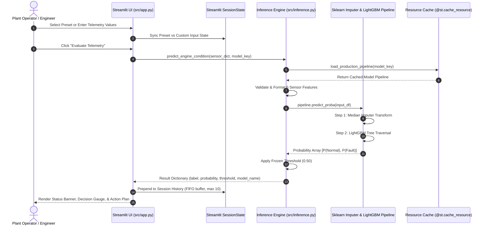

# EngineSense — System Architecture

This document describes the architectural design, component boundaries, execution lifecycle, and reactive state model of the EngineSense predictive maintenance and engine condition classification system.

---

## 1. System Overview

The system is designed as a modular, production-ready machine learning application that accepts instantaneous multicore engine telemetry readings, validates them against strict physical schema constraints, executes leakage-free preprocessing, and delivers binary condition classifications with transparent risk metrics.

```
+-------------------------------------------------------------------------+
|                           User Interface Layer                          |
|  Streamlit Mission-Control Dashboard (src/app.py)                       |
|  - 6 Telemetry Channel Cards     - Dual Selectable Model Cards          |
|  - 4 Diagnostic Test Presets     - Continuous Risk Decision Meter       |
|  - Bidirectional Input Sync      - Session Telemetry History Table      |
+------------------------------------+------------------------------------+
                                     |
                                     v
+-------------------------------------------------------------------------+
|                         Inference Engine Layer                          |
|  Production Predictor (src/inference.py)                                |
|  - Input Validation & Clamping    - C++ OpenMP Runtime Initialization   |
|  - Model Caching (@cache_resource)- Decision Threshold Evaluation (0.50)|
+------------------------------------+------------------------------------+
                                     |
                                     v
+-------------------------------------------------------------------------+
|                    Scikit-Learn Pipeline Wrapper                        |
|  (models/production/engine_condition_model.joblib)                      |
|                                                                         |
|  Step 1: SimpleImputer(strategy="median")                               |
|          Fitted strictly on 12,502 training observations                |
|                                                                         |
|  Step 2: LGBMClassifier(subsample=0.7, subsample_freq=1, lr=0.01)       |
|          100 boosting trees, 63 leaves, colsample_bytree=0.85           |
+-------------------------------------------------------------------------+
```

---

## 2. End-to-End Execution Flow

The sequence diagram below illustrates the end-to-end data lifecycle from user interaction to diagnostic presentation:



---

## 3. Component Architecture

### 3.1 Presentation Layer (`src/app.py`)
- **Industrial Mission-Control Design**: Styled using custom CSS variables (monochromatic slate surfaces `#0b1120`, `#111827`, border accents `#1f2937`, `#374151`, and high-contrast diagnostic indicators).
- **Telemetry Input Deck**: 6 dedicated numeric input cards with unit tags, step sizes, and dataset reference percentiles ($P_{25} - P_{75}$ from training observations).
- **Preset Selector**: 4 demonstration scenarios:
  1. *Nominal Steady-State*: Engine idling within normal parameters.
  2. *Low Oil Pressure*: Reduced lubrication delivery head with elevated temperature.
  3. *High Temperature & Fuel*: High thermal load and pressurized injection.
  4. *Cold Start Idle*: Low rotational speed and depressed operating temperatures.
- **Model Selection Cards**: Two visually distinct selectable cards in the sidebar:
  - *LightGBM (Promoted Production)*: Subsampling-corrected gradient boosting classifier (Validation F1: 0.7813, Holdout Recall: 94.68%).
  - *Random Forest (Baseline)*: Original baseline model (`models/best_model.joblib`, Holdout F1: 0.7683, Holdout Recall: 89.65%).
- **Diagnostic Meter**: Gauge rendering continuous fault risk probability ($0.0\% - 100.0\%$) with a prominent operating threshold marker at 0.50.
- **Session Audit Table**: Persistent audit log displaying the last 10 predictions with model provenance, raw telemetry inputs, and timestamps.

### 3.2 Reactive State Machine (`src/app.py`)
To prevent desynchronization between presets and manual edits, `src/app.py` implements a deterministic bidirectional state machine:

1. **Preset Selection Callback**: When the user switches presets in `preset_selector`, session state copies all six preset values into their corresponding `sensor_<key>` widget keys, updates `active_preset` to the chosen preset, and sets `current_preset_label` to match.
2. **Sensor Modification Callback**: When any sensor value is changed via its number input widget, `on_sensor_change()` triggers immediately, updating `active_preset` to `"Custom Input"` and resetting `preset_selector` index to 0. This guarantees the dashboard never displays a preset name (e.g., "Low Oil Pressure") when the inputs have been altered.
3. **Session History Ring Buffer**: A list of evaluation records stored in `st.session_state.history`. Each new evaluation is prepended (`history.insert(0, entry)`), and truncated to a maximum of 10 items.

### 3.3 Inference Engine (`src/inference.py`)
- **Input Schema Enforcement**: Features are validated against strict type, range, and ordering rules. The expected column order is strictly preserved:
  1. `Engine_RPM`
  2. `Lub_Oil_Pressure`
  3. `Fuel_Pressure`
  4. `Coolant_Pressure`
  5. `Lub_Oil_Temperature`
  6. `Coolant_Temperature`
- **Windows Runtime Initialization**: In 64-bit Windows environments, LightGBM relies on dynamic C++ OpenMP runtime libraries (`vcomp140.dll` / `libgomp`). Loading a serialized pipeline using `joblib.load()` before `lightgbm` is explicitly imported can trigger access violations or threading deadlock. `src/inference.py` guarantees `import lightgbm` occurs prior to unpickling.
- **Resource Caching**: `@st.cache_resource` ensures pipeline artifacts (`.joblib`) are read from disk exactly once per server process lifecycle. Subsequent inference calls reuse the in-memory object graph.
- **Decision Engine**: Computes decision score $S_{\text{fault}} = P(Y=1 \mid \mathbf{x})$. The condition is declared `"FAULTY / ANOMALOUS"` if $S_{\text{fault}} \ge \tau$ (where $\tau = 0.50$), and `"NORMAL / HEALTHY"` otherwise.

### 3.4 Preprocessing and Transformation Pipeline
Both model pipelines encapsulate self-contained preprocessing:
- **Missing Value Imputation**: `sklearn.impute.SimpleImputer(strategy='median')` fitted exclusively on training fold observations ($N=12,502$).
- **No Data Leakage**: Global dataset statistics (mean/median/std) were never computed across test or validation sets.
- **Self-Contained Transformation**: Missing values in production queries are imputed using the frozen training medians serialized inside the `.joblib` artifact.

---

## 4. Hardware & Performance Profile

| Dimension | Specification | Notes / Environment |
|:---|:---|:---|
| **Batch Inference Execution** | **0.0525 seconds** across 3,907 holdout samples | Measured via `pipeline.predict_proba()` on Python 3.12.5 / 64-bit Windows |
| **Batch-Average Latency** | ~**0.0134 ms / sample** ($13.4\,\mu\text{s}$) | Vectorized offline batch processing; not a single-request SLA guarantee |
| **Measured Batch Throughput** | ~**74,400 samples / second** | ~3.5x faster than baseline Random Forest (0.1824s, ~21,400 samples/sec) |
| **Pipeline Memory Footprint** | ~**687 KB** disk artifact, ~**12 MB** resident | Serialized Scikit-Learn `Pipeline` wrapping `SimpleImputer` and `LGBMClassifier` |
| **Concurrency Support** | Thread-safe in-memory inference | Scikit-Learn / LightGBM C++ OpenMP backend (`n_jobs=2`) |
| **Cold Startup Time** | **< 1.2 seconds** | Application launch to UI ready state |

> [!NOTE]
> Latency figures represent measured offline vectorized batch performance on the development host during Phase 9 evaluation. They reflect computational throughput rather than single-call network API roundtrip latency or certified real-time hard-deadline guarantees.

---

## 5. Security & Isolation Controls

1. **Stateless Prediction**: Prediction endpoints do not write to disk or external databases during inference.
2. **Defensive Input Handling**: Sensor values are coerced into standard 64-bit IEEE 754 floats. NaN or null values trigger defensive pipeline imputation rather than unhandled server exceptions.
3. **Model Artifact Integrity**: Production models are tracked and verified against their cryptographic SHA-256 digests (`e364d18ba228de24f625d92d8f28b4d3acb43ef7ad5c48274677577df60f692e`).
